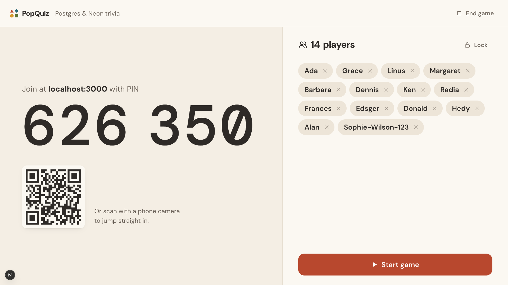
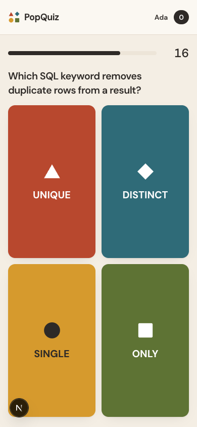
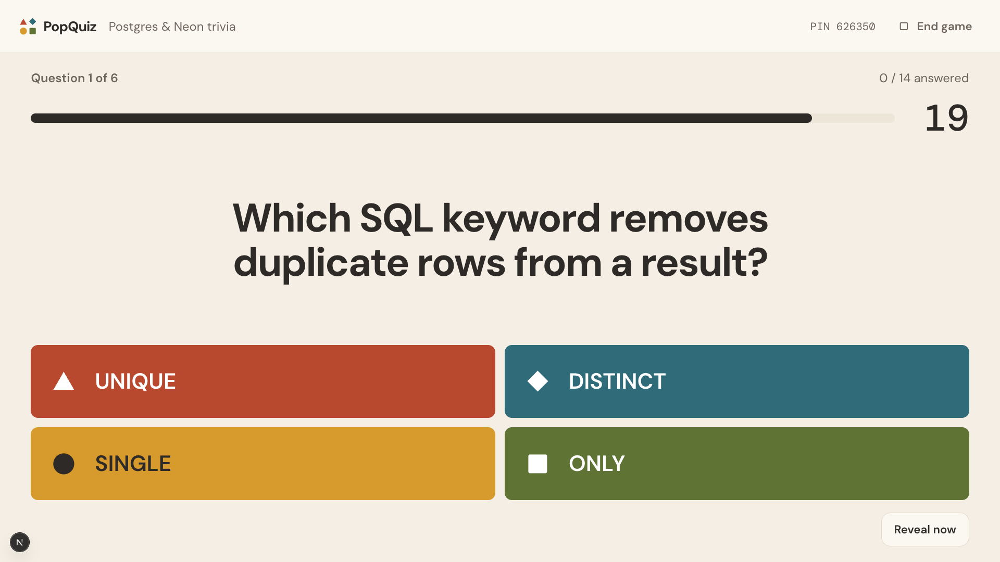
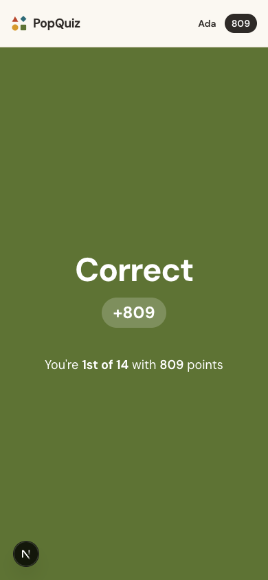
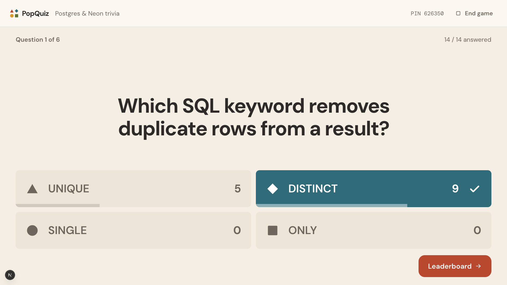
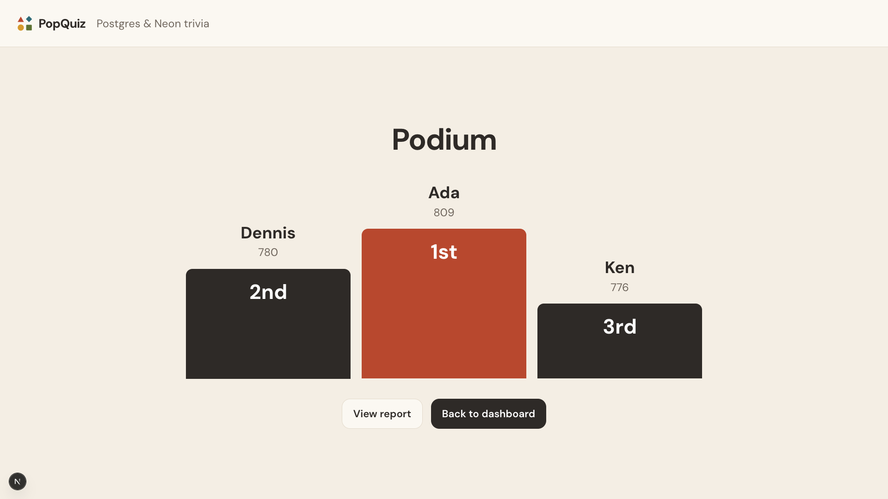

# PopQuiz

An open-source live quiz game, like Kahoot, built on [Neon](https://neon.com). Hosts write a quiz and run it on a big screen. Players join from their phones with a game PIN and a nickname. They do not need an account.

**Live demo:** https://opensource-kahoot.vercel.app

It is inspired by the Supabase community's [kahoot-alternative](https://github.com/supabase-community/kahoot-alternative). This version uses Neon for everything on the backend.

| Host screen                                                    | Player phone                                            |
| -------------------------------------------------------------- | ------------------------------------------------------- |
|  |  |
|      |   |
|  |                                                         |
|                     |                                                         |

## Features

- **Quizzes.** Create, edit, duplicate and delete quizzes. Each question is a quiz question with 2 to 4 answers, or a true or false question. Set a time limit (5 seconds to 4 minutes), points (standard, double or none) and an optional image. A sample quiz gets new hosts started.
- **Live games.** The lobby shows the PIN, a QR code and the players as they join. The host can lock the lobby and remove players. Each question shows a countdown. The answer is revealed when time runs out or when everyone has answered. Then come the answer counts, a leaderboard and a podium at the end.
- **Kahoot-style scoring.** A correct answer is worth up to 1000 points. The value falls to 500 at the time limit, so faster answers score more. The database clock decides the time, not the browser.
- **No cheating by inspection.** The correct answer and the scores are hidden in SQL until the host reveals them. A player who reads the network traffic sees nothing early.
- **Reports.** Final standings, accuracy per question and a CSV download.

## How it uses Neon

| Neon service            | What it does here                                                                                                                                                                                                                                                                                              |
| ----------------------- | -------------------------------------------------------------------------------------------------------------------------------------------------------------------------------------------------------------------------------------------------------------------------------------------------------------- |
| **Postgres**            | Stores quizzes, games, players and answers. It is the only source of truth. Scores are computed inside the insert that records an answer.                                                                                                                                                                      |
| **Managed Better Auth** | Hosts sign up and sign in. Players do not use it. They get a random token in an httpOnly cookie, and the database keeps only its hash.                                                                                                                                                                         |
| **Realtime**            | Every live screen is a live SQL query: game state, current question, players, answer counts, standings and the player's own answers. The server seals each query after it checks the host session or the player cookie. Writes return their transaction id, so the screen updates the moment the change lands. |
| **Functions**           | `functions/janitor.ts` runs every 15 minutes on a schedule trigger. It ends games that the host abandoned for 2 hours, and deletes lobbies that never started after a day.                                                                                                                                     |

The app itself is a Next.js 16 App Router project, hosted on Vercel. It uses Drizzle with `node-postgres`.

## Run it yourself

You need Node.js 22.18 or newer and a Neon account. Functions currently run in `aws-us-east-1`, `aws-us-east-2`, `aws-eu-central-1` and `aws-ap-southeast-1`, so create your project in one of those regions.

```bash
git clone https://github.com/Praneeth16/opensource-kahoot.git && cd opensource-kahoot
npm install
npm i -g neon@latest
neon login
neon init -y --services postgres,auth,functions,realtime   # links or creates a Neon project
neon deploy --update-existing                              # enables Auth and Realtime, deploys the janitor, writes .env.local
printf '\nNEON_AUTH_COOKIE_SECRET=%s\n' "$(openssl rand -base64 32)" >> .env.local
npm run db:push                                            # creates the tables
npm run dev                                                # http://localhost:3000
```

### Social sign-in

Hosts can sign in with Google out of the box: Neon enables it on every branch with shared credentials. Those show Neon's name on Google's consent screen, so use your own Google OAuth app for production. GitHub and Vercel sign-in always need your own OAuth app.

1. Create the OAuth app with the provider. Set its callback (redirect) URI to `{NEON_AUTH_BASE_URL}/callback/{provider}`, for example `.../neondb/auth/callback/github`.
2. Add it to the branch: `neon neon-auth oauth-provider add --provider-id github --oauth-client-id <id> --oauth-client-secret <secret>`.
3. List it for the sign-in page: `NEXT_PUBLIC_OAUTH_PROVIDERS=google,github` (default `google`), locally in `.env.local` and on Vercel.

See Neon's [Set up OAuth](https://neon.com/docs/auth/guides/setup-oauth) guide for details.

Next.js must run on port 3000, because that is the origin Realtime allows in `neon.ts`. If port 3000 is busy, the live screens stay stuck on connecting.

## Use with Claude, Codex and other AI assistants

PopQuiz is an MCP server too, at `https://<your-app>/api/mcp` (Streamable HTTP). Ask your assistant to write a quiz, host it and read the results, for example: _"Create a 10-question quiz about the solar system, mix in a few true or false questions, then host it."_ A person still runs the game on the big screen.

1. Sign in, open **AI assistants** (`/connect`) and create a personal access token. It is shown once and can be revoked there.
2. Add the server. The page fills in your URL and token:

```bash
# Claude Code
claude mcp add --transport http popquiz https://<your-app>/api/mcp \
  --header "Authorization: Bearer <token>"

# Codex
export POPQUIZ_TOKEN=<token>
codex mcp add popquiz --url https://<your-app>/api/mcp --bearer-token-env-var POPQUIZ_TOKEN
```

Codex asks before each tool call. To skip that, which `codex exec` needs, add `default_tools_approval_mode = "approve"` under `[mcp_servers.popquiz]` in `~/.codex/config.toml`. Cursor and other clients take `{ "url": …, "headers": { "Authorization": "Bearer <token>" } }`. Claude Desktop connects through `npx mcp-remote <url> --header "Authorization: Bearer <token>"`.

| Tool                                        | What it does                                                    |
| ------------------------------------------- | --------------------------------------------------------------- |
| `list_quizzes`, `get_quiz`                  | Read your quizzes                                               |
| `create_quiz`, `update_quiz`, `delete_quiz` | Write them, with the same validation as the editor              |
| `host_game`                                 | Open a lobby and return the PIN, host screen link and join link |
| `list_games`, `get_results`                 | Standings and per-question accuracy                             |

A token only reaches its own host's quizzes and games. Games play a frozen copy of the quiz, so an assistant editing a quiz never changes a running or finished game.

## End-to-end tests

`npm run e2e` plays real games in Chrome with Playwright: a host builds a quiz from scratch (multiple correct answers, double and no-points questions, a timeout), runs it with several players, removes and locks out players, and then edits and re-hosts. Every stored score is checked against the formula, and the final screens, report and CSV are checked against the database. A second test plays the sample quiz to the podium, and a third drives the MCP server with an MCP client: it creates a quiz, hosts it for players in browsers, reads the results, and checks token revocation and isolation between hosts.

```bash
npx playwright install chromium     # once; or set PLAYWRIGHT_CHANNEL=chrome to use your installed Chrome
npm run e2e                         # starts the dev server on port 3000
E2E_BASE_URL=https://your-app.vercel.app npm run e2e   # or test a deployment
```

The suite reads `DATABASE_URL` from `.env.local` to audit scores. Its hosts sign up as `popquiz.e2e+…@example.com`, and their quizzes and games are deleted after the run. The test accounts stay in Neon Auth.

## Deploy to Vercel

1. Import the repo in Vercel, or run `npx vercel`.
2. Set these environment variables from your `.env.local`: `DATABASE_URL`, `NEON_AUTH_BASE_URL`, `NEON_REALTIME_URL`, `NEON_REALTIME_SECRET` and `NEON_AUTH_COOKIE_SECRET`.
3. Add your Vercel URL to `preview.realtime.allowedOrigins` in `neon.ts`, then run `neon deploy --update-existing`.
4. Trust the domain for sign-in: `neon neon-auth domain add https://your-app.vercel.app`.

`npm run build` needs no environment variables, so builds work without secrets.

## Project layout

```
neon.ts                     Neon services: Auth, Realtime origins, the janitor Function and its schedule
functions/janitor.ts        The Neon Function
src/lib/schema.ts           Drizzle schema (snake_case columns, which Realtime needs)
src/lib/live.ts             Every live query, with answer masking in SQL
src/app/actions/            Server Actions for quizzes, host controls and players
src/app/api/games/[id]/live Renews sealed live queries for hosts and players
src/app/host/[gameId]       The host's big screen
src/app/play/[gameId]       The player's phone
src/app/quizzes/            The quiz editor
src/app/reports/            Reports and CSV
```

## License

MIT
